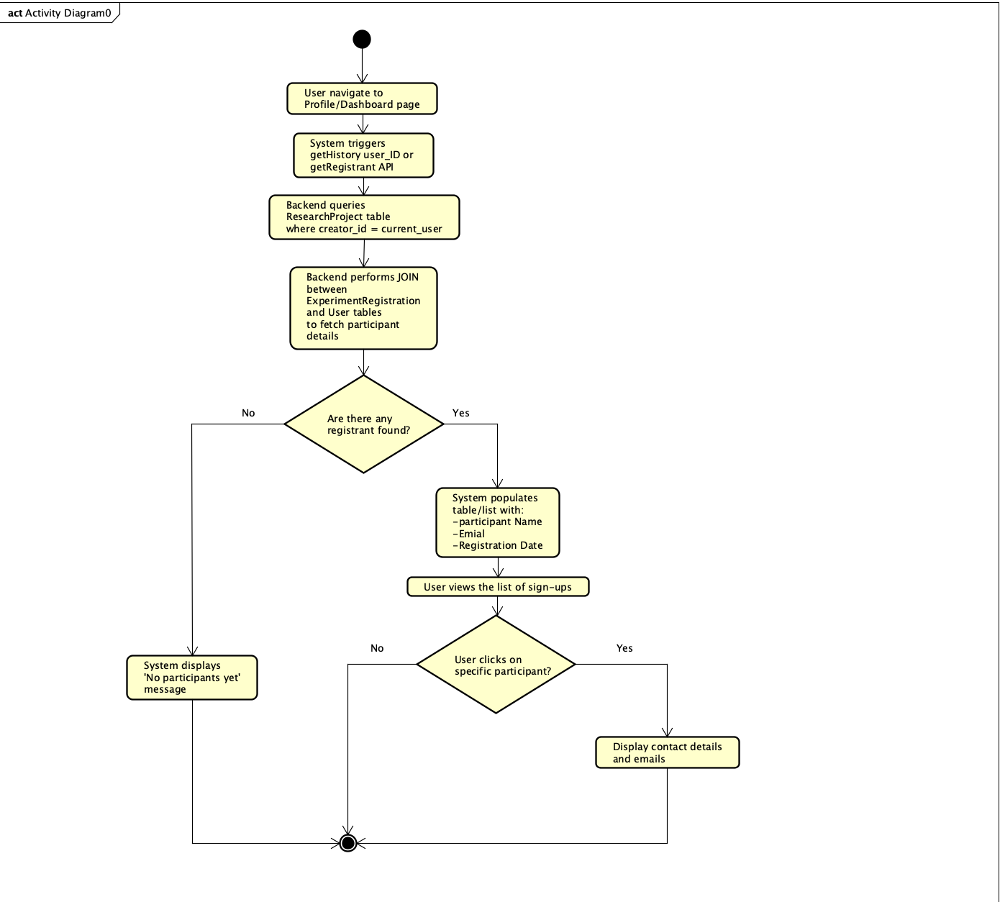
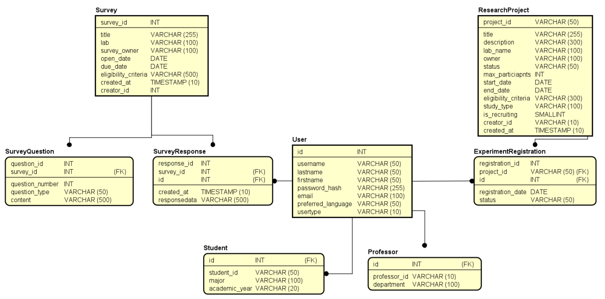
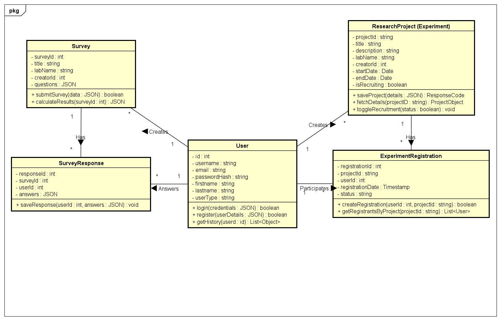
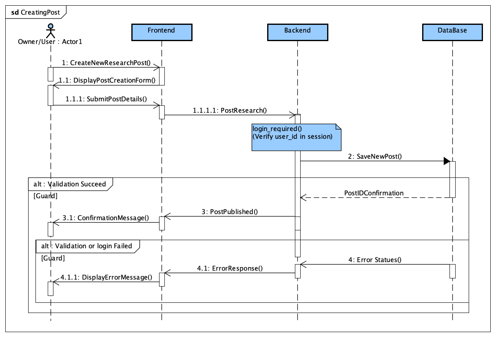

# Rinder: ResearchMatch

## Project overview

Rinder is a platform designed to support research participation and collaboration among ISSE students and researchers. It addresses the common difficulty of recruiting participants by providing a centralized space where users can advertise research projects, share surveys, and manage engagement more efficiently. Because first and second year students will need to prepare to choose a lab in their third year, the system also helps such students discover ongoing research within ISSE, enabling them to offer feedback and gain early insight into different laboratories [1]. The main objectives of Rinder: ResearchMatch are to streamline participant recruitment, increase visibility of student research, and foster a more open, collaborative research environment within ISSE. The scope of the PBL4 implementation includes creating and sharing surveys and research posts, completing surveys, expressing interest in specific projects, and browsing available studies through both list and calendar views. Future extensions will focus on the notification system.


## Full final report

Read the [complete Group J final report](docs/final-report.md) for all requirements, diagrams, implementation details, recorded test results, lessons learned, references, and the appendix. The key diagrams and setup instructions remain below.

## Features

- Register an account, sign in, and sign out using session-based authentication.
- Browse research experiments and view study details and eligibility criteria.
- Register for experiments and view participant lists.
- Browse surveys, submit responses, and view survey results.
- Create experiment and survey listings.
- View surveys and experiments on a shared calendar.
- View participation history from the profile page.

## Diagrams from the final report

The following original figures and accompanying paragraphs are reproduced from *PBL4: Group J Final Report*.

### Figure 2.3 Activity Diagram



The Activity Diagram illustrates the process for a project owner viewing their list of registrants. When the user opens their Profile or Dashboard, the system automatically sends a getHistory or getRegistrant API request using their user ID. The backend identifies projects created by the user and retrieves participant data through a JOIN between the ResearchProject, ExperimentRegistration, and User tables. If no registrants are found, the system displays a “No participants yet” message. Otherwise, it shows a table of participant names, emails, and registration dates. The user may select a participant to view their contact details, after which the activity ends, unless they choose not to select anyone.

### Figure 3.2 E/R Diagram



The project’s database uses a relational schema to maintain data integrity across all research-related entities, as shown in the E/R diagram. The core User entity employs inheritance to differentiate Studentsff and Professors, enabling role-specific attributes. One-to-many relationships link each user to the Surveys and ResearchProjects they create, while participation is handled through SurveyResponse and ExperimentRegistration tables that connect users to specific studies. Surveys are further broken down into SurveyQuestion to support flexible question counts. Overall, the schema provides a robust MySQL-based storage layer that supports the system’s dynamic behavior.

### Figure 3.3.1 Coding Class Diagram



Figure 3.3.1 acts as a technical blueprint for the system’s internal logic, showing how the Flask backend and React frontend interact through defined methods and data structures. Unlike the previous E/R diagram, it highlights application behavior by outlining methods such as register, login, and add_project, which map directly to API routes in the Flask code. It also reflects how user state is managed through session-based authentication and the currentUser logic used to track ownership and participation. The diagram includes implementation-specific types to mirror the formData and fetch payloads used in React. Overall, it clarifies the application’s execution flow and distinguishes the dynamic logic from the underlying database structure.

### Figure 3.3.2 Sequence Diagram for Creating a New Research ProjectPost



Figure 3.3.2 illustrates the use case of creating a new research post, showcasing the interaction between the user, the web application frontend, the API gateway, and the database. The process begins when the user initiates a request to create a new research post, prompting the web application to display the project creation form. Once the user submits the project details, the frontend transmits this information to the API gateway, which subsequently attempts to save the new post to the database. The system then utilizes an alternative structure to handle validation outcomes: if validation succeeds, the database confirms the post ID, and the API gateway notifies the frontend that the post is published, resulting in a confirmation message for the user. Also, if validation succeeds, another validation is performed to check if a user is logged in given that this ability is only for logged-in users. Conversely, if validation fails, which can occur with a database error or invalid input, the API gateway receives an error status from the database and triggers the frontend to display an appropriate error message to the user. This flow ensures that data is only persisted when valid and provides immediate feedback to the researcher throughout the creation lifecycle.

## Technology

| Layer | Tools |
| --- | --- |
| Frontend | React 18, React Router 6, Vite 5, CSS |
| Backend | Python, Flask, Flask-CORS, Flask-MySQLdb, Werkzeug |
| Database | MySQL; supplied dumps use MySQL 8 collation syntax |

## Project structure

```text
src/                       Main React application, pages, and components
backend/flask_app.py       API used by the main frontend
backend/rinder_*.sql       Table dumps for the main API
backend/requirements.txt   Python dependencies
backend/flask_backend/     Separate backend implementation and SQL dump
backend/old/               Older table dumps
frontend/public/           Alternate frontend files
index.html                 Vite entry page
vite.config.js             Vite configuration
package.json               Frontend scripts and dependencies
package-lock.json          Locked frontend dependency tree
docs/final-report.md       Complete final report, including all diagrams and test results
docs/diagrams/             Original diagram images from the final report
.env.example               Local backend configuration template
```

Use the root-level frontend and `backend/flask_app.py` together. The alternate implementations are not required for this workflow.

## Local development

The application source is imported from the supplied `GroupJ-main (2).zip` archive. Installed dependencies and generated frontend output are excluded from version control.

### Prerequisites

- Node.js 18 or newer, as required by Vite 5, and npm; use a currently supported Node.js LTS release.
- Python 3 with `venv` and pip.
- A running MySQL 8-compatible server and a local database account.
- Platform-specific MySQL client development libraries, compiler tools, and `pkg-config` if needed to install `mysqlclient`, a dependency of Flask-MySQLdb.

Run the commands below from the project root. Full application startup requires your own MySQL instance and local configuration.

### 1. Install frontend dependencies

```sh
npm ci
```

### 2. Prepare the database

Create a dedicated local development database named `rinder`. Import the following files into that database in this order using your MySQL client:

1. `backend/rinder_users.sql`
2. `backend/rinder_students.sql`
3. `backend/rinder_professors.sql`
4. `backend/rinder_research_projects.sql`
5. `backend/rinder_survey.sql`
6. `backend/rinder_survey_questions.sql`
7. `backend/rinder_survey_responses.sql`
8. `backend/rinder_experiment_registrations.sql`

For example, for each file:

```sh
mysql -u YOUR_LOCAL_USER -p rinder < backend/rinder_users.sql
```

The published dumps contain schemas only; exported user records and sample rows have been removed. They include table replacement statements, so import them only into a disposable development database. Do not mix them with the alternate schema in `backend/flask_backend/rinder.sql` or the older dumps.

Give your local application database account access to `rinder`. The backend defaults to the username `rinder`; you can override it in the configuration below.

### 3. Install and configure the backend

```sh
python3 -m venv .venv
. .venv/bin/activate
python -m pip install -r backend/requirements.txt
cp .env.example .env
```

Edit `.env` with your own database credentials and a nonempty `FLASK_SECRET_KEY`. Generate a fresh session key locally with:

```sh
python -c 'import secrets; print(secrets.token_hex(32))'
```

| Variable | Purpose | Default |
| --- | --- | --- |
| `MYSQL_HOST` | Database hostname | `localhost` |
| `MYSQL_USER` | Local database account | `rinder` |
| `MYSQL_PASSWORD` | Password for that account | Required |
| `MYSQL_DB` | Database name | `rinder` |
| `FLASK_SECRET_KEY` | Session signing key | Required and nonempty |

The backend reads environment variables. It does not automatically load `.env`. Load the file in your shell before starting the API; quote values containing shell special characters. Keep `.env` private; it is ignored by Git.

Start the API:

```sh
set -a
. ./.env
set +a
python backend/flask_app.py
```

The API uses port **8080**. The development entry point enables Flask debug mode.

### 4. Start the frontend

In a second terminal, from the project root:

```sh
npm run dev -- --port 5173 --strictPort
```

Use the frontend through the `localhost` hostname on port **5173**. The API permits that exact frontend origin for credentialed CORS requests, and the frontend hardcodes API requests to `http://localhost:8080`.

For a remote cloud workspace, these localhost addresses refer to the browser's own machine. Remote browser access requires suitable forwarding or a separate API URL and CORS configuration change.

## Build and validation

```sh
npm run build
npm run preview
```

The build command generates frontend assets in `dist/`. Preview serves the frontend build; it does not start Flask or MySQL.

No automated test, lint, or type-check scripts are declared in the root `package.json`. With MySQL and Flask running, a useful initial API check is:

```sh
curl --fail http://localhost:8080/api/projects
```

Expect a JSON list of experiments. A successful frontend build alone does not verify database connectivity, authentication, or participation workflows. Manually check registration, login, experiment registration, survey submission, calendar display, and profile history before claiming full application readiness.

## Current limitations

- API addresses and the allowed frontend origin are fixed to the local development ports above.
- Python dependencies use version ranges rather than an exact lockfile.
- Multiple frontend, backend, and schema variants are bundled; use the main paths documented above.
- The included Flask debug server is intended for local development. Production deployment requires separate configuration and validation.

## References

[1] Ritsumeikan University, ISSE Curriculum Overview. College of Information Science and Engineering, Ritsumeikan University. Accessed: Dec. 2025.
