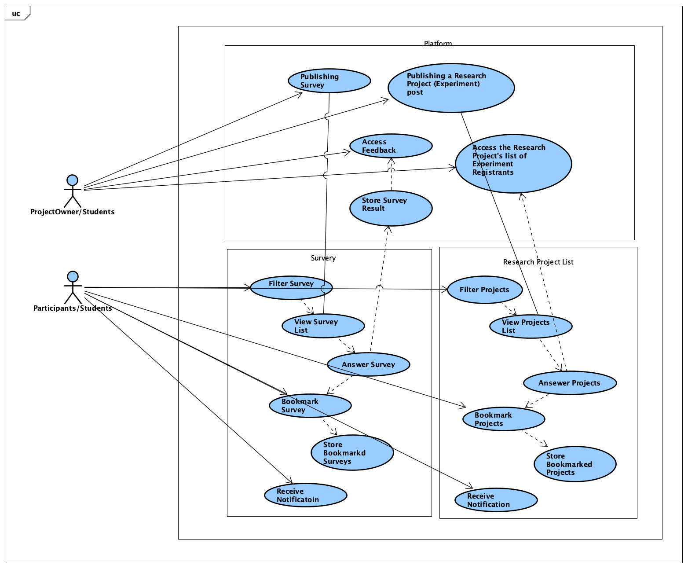
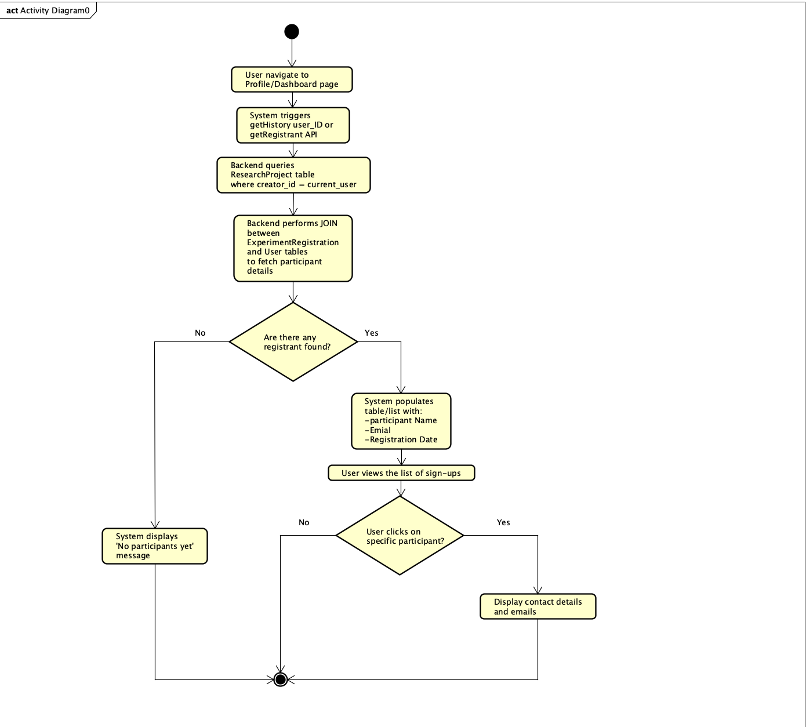
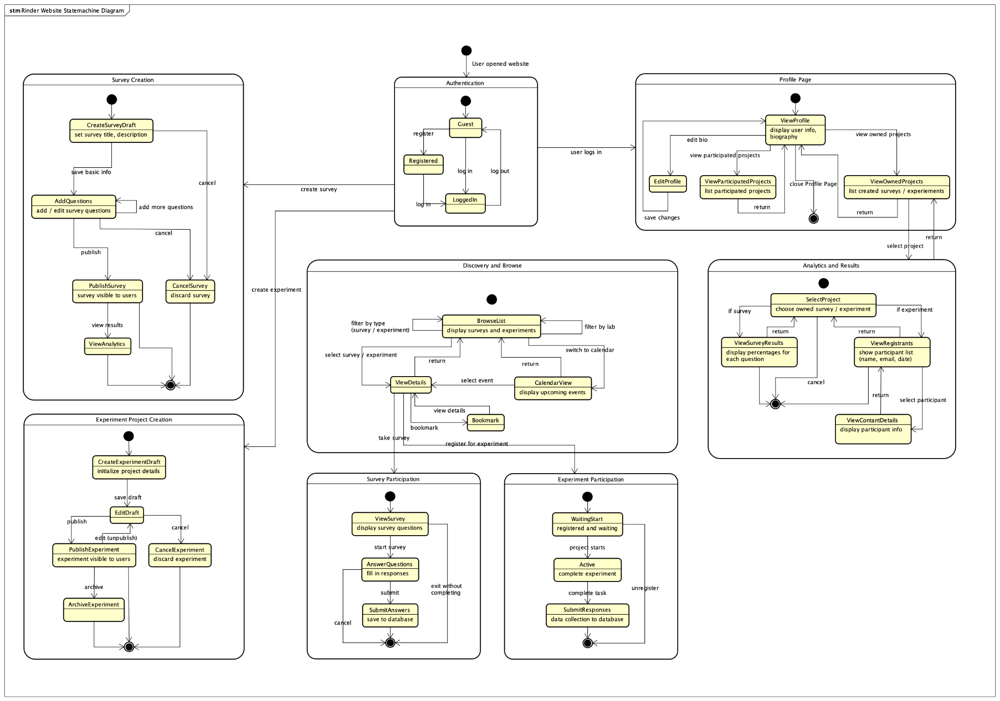
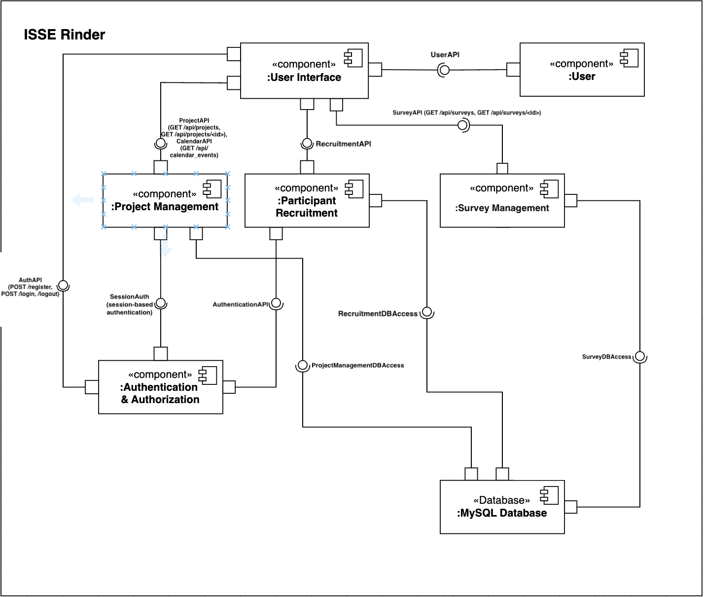
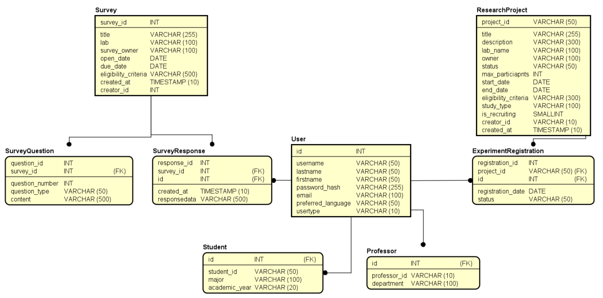
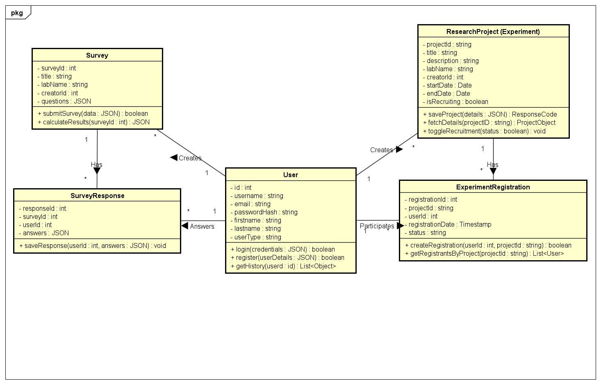
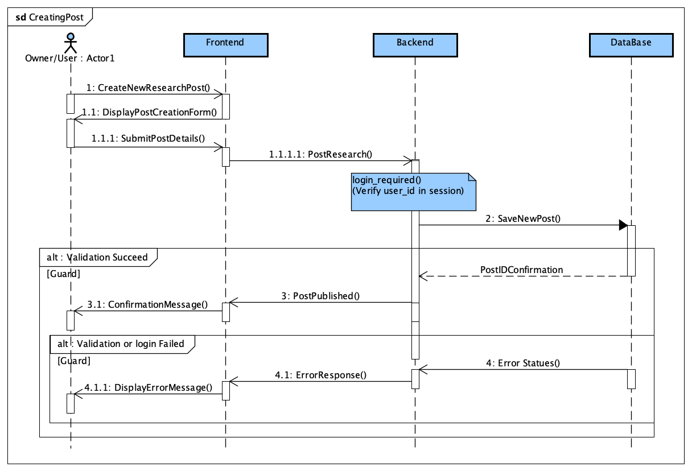
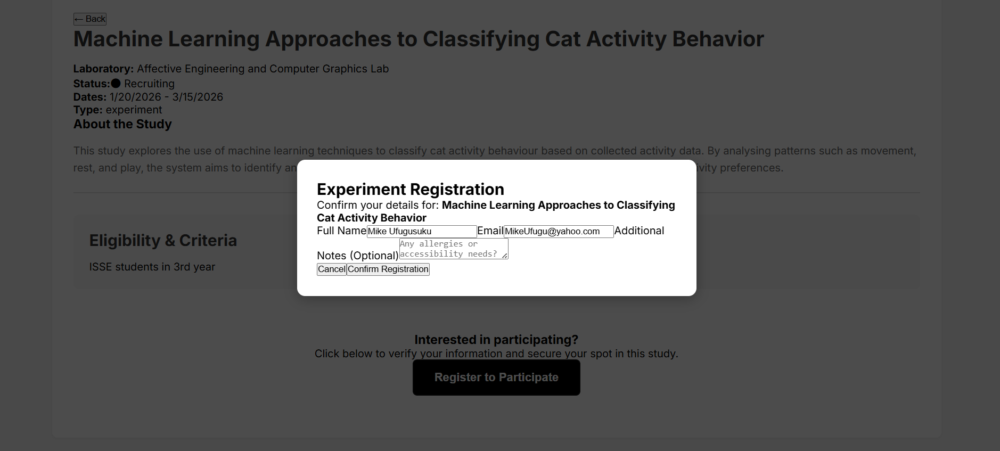
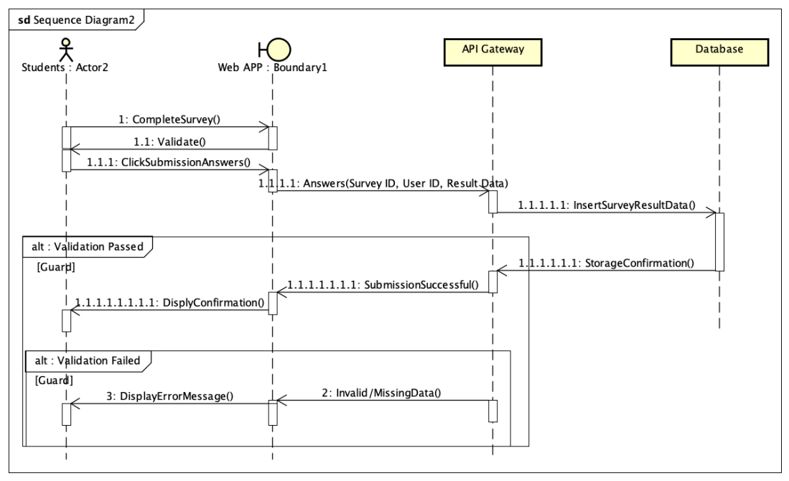

# 最終レポート

[English](final-report.md) | **日本語**

本ページは、最終レポートの本文を日本語に翻訳し、GitHub 向けにレイアウトを調整したものである。テスト結果は原本に記録された内容に基づく。図は原本の画像を使用している。原本の表紙に記載された学籍番号と個人のメールアドレスは、公開用の版では省略している。

[プロジェクトの README に戻る](../README.ja.md)

## I. はじめに

Rinder: ResearchMatch は、ISSE の学生と研究者の研究参加や連携を支援するために設計されたプラットフォームである。研究プロジェクトの募集情報の掲載、アンケートの共有、参加者とのやり取りを一か所で効率的に行えるようにすることで、参加者募集に共通する課題に対応する。また、1・2年生は3年次の研究室選択に向けて準備する必要があるため、本システムは、ISSE 内で進められている研究を知り、フィードバックを提供しながら各研究室への理解を早い段階で深められるよう支援する [1]。Rinder: ResearchMatch の主な目的は、参加者募集の効率化、学生の研究の認知度向上、そして ISSE 内での開かれた協力的な研究環境の促進である。PBL4 での実装範囲には、アンケートや研究募集投稿の作成・共有、アンケートへの回答、特定の研究プロジェクトへの参加希望の登録、一覧・カレンダー形式での研究情報の閲覧が含まれる。今後の機能拡張では、通知システムに重点を置く予定である。

## II. 要件と分析

### A. 機能要件

Rinder の機能要件は、ユーザーが研究の募集情報を掲載し、アンケートを共有し、研究参加の機会を見つけ、参加状況を管理できるようにすることを中心としている。ユーザーは、研究情報の投稿、一覧・カレンダー形式でのアンケートやプロジェクトの閲覧、種類による絞り込み、プロジェクトのブックマーク、通知の受信を行える必要がある。システム側の要件は、アンケート結果やブックマークの保存、投稿の確実な公開、ユーザーの条件に基づくデータの絞り込み、時系列での活動表示、適時の通知を実現することにより、これらの操作を支えるものである。

### B. 非機能要件

非機能要件は、使いやすさ、性能、アクセシビリティ、信頼性に重点を置いている。インターフェースは直感的で、事前の訓練を必要とせず、ユーザーが研究情報をすばやく見つけられるものでなければならない。システムは、参加可能な研究を分かりやすく提示し、英語と日本語の両方に対応するとともに、さまざまな端末や入力方法で動作する必要がある。性能面では、一覧を3秒以内に読み込み、絞り込み結果を2秒以内に返すことを想定している。システム全体の制約には、安全なデータ保存、正確な状態更新、適時の通知、信頼できる絞り込み機能が含まれる。これらの要件を踏まえ、ユーザーの期待とシステム上の制約の両方を満たすよう、Rinder: ResearchMatch の設計を進めた。

### C. ユースケースモデリングと振る舞いの分析

#### 図2.2 ユースケース図

上の図は、Rinder: ResearchMatch の主要なユースケースを示している。以下で説明するユースケースは、PBL4 で実装した主な機能に対応する。ユーザーは、研究プロジェクトのために構造化されたデータを収集するアンケートを作成できる。また、研究内容を紹介し、参加候補者を募集するための研究プロジェクト投稿を作成できる。研究者が提供するアンケートに回答できるほか、実験への参加希望フォームを送信し、特定の研究に参加する意思を示すこともできる。さらに、アンケート結果を閲覧して収集した回答を分析したり、実験の参加登録者一覧にアクセスして参加状況を管理したりできる。

#### 図2.3 アクティビティ図

このアクティビティ図は、プロジェクトの作成者が参加登録者の一覧を確認する手順を示している。ユーザーがプロフィールまたはダッシュボードを開くと、システムはそのユーザー ID を使用し、`getHistory` または `getRegistrant` の API リクエストを自動的に送信する。バックエンドは、そのユーザーが作成したプロジェクトを特定し、`ResearchProject`、`ExperimentRegistration`、`User` の各テーブルを `JOIN` して参加者データを取得する。参加登録者が見つからない場合は、「No participants yet」（参加者はまだいません）というメッセージを表示する。参加登録者がいる場合は、氏名、メールアドレス、登録日を表形式で表示する。ユーザーは参加者を選択して連絡先の詳細を確認でき、確認後に処理が終了する。誰も選択しない場合も、そのまま処理を終了する。

#### 図2.4 ステートマシン図

図2.4 は、Rinder: ResearchMatch におけるユーザー操作の一連の流れを示している。認証、情報の閲覧、アンケートや実験プロジェクトの作成、研究への参加、分析結果の閲覧という各操作の間を、ユーザーがどのように移動するかを表している。アンケート作成、実験プロジェクト作成、検索・閲覧、アンケート参加、実験参加、プロフィール管理、分析といった各サブシステムは、研究活動の下書き、公開、参加、分析を行う際の状態遷移を示す。この図は、プロジェクトの作成者・所有者と参加者の両方の作業の流れを扱い、ログイン、コンテンツ作成、タスクの完了、結果の閲覧などの操作によって、プラットフォーム全体で状態がどのように移り変わるかを明らかにしている。

## III. システム設計

### A. アーキテクチャ設計

#### 図3.1 コンポーネント図

システムのアーキテクチャは、ユーザー操作、認証、プロジェクト管理、参加者募集、アンケート管理などの主要な責務を分離する、モジュール化されたコンポーネント群で構成されている。フロントエンドでは、React で実装したユーザーインターフェースのコンポーネントがすべてのユーザー操作を処理し、`UserAPI`、`ProjectAPI`、`SurveyAPI` などの API を通じてリクエストを送信する。これらのリクエストはバックエンドで受信され、複数の Flask ベースのコンポーネントがアプリケーションの中核となる処理をそれぞれ内部にまとめている。図3.3.1 の各コンポーネントは、フロントエンドから非同期で呼び出せる `/api/projects`、`/api/recruitment`、`/api/surveys` などの専用エンドポイントを用いて、それぞれの業務ロジックを実装する [2]。コンポーネント間の通信は API を介してモジュール単位で行われ、クロスオリジンリソース共有（CORS）により、異なる端末上のフロントエンドクライアントからバックエンドのサービスへ安全にアクセスできる。各コンポーネントが必要とする永続データは、中央の MySQL データベースにすべて保存され、専用のデータベースアクセス用インターフェースを通じて利用される。このコンポーネントベースのアーキテクチャにより、各サブシステムを独立して発展させることができる。例えば、基盤となる認証機構やデータベースのスキーマに影響を与えずに、ユーザーインターフェースやアンケート管理のロジックを変更できる。

### B. データベース設計

#### 図3.2 E/R 図

本プロジェクトのデータベースは、E/R 図に示すように、研究に関わるすべてのエンティティ間でデータの整合性を維持するために、リレーショナルスキーマを採用している。中核となる `User` エンティティでは、継承を用いて学生と教員を区別し、それぞれの役割に応じた属性を扱えるようにしている。各ユーザーと、そのユーザーが作成する `Surveys` や `ResearchProjects` は1対多の関係で結ばれている。一方、参加に関する情報は、ユーザーと特定の研究を結び付ける `SurveyResponse` テーブルと `ExperimentRegistration` テーブルで管理する。アンケートは、設問数を柔軟に扱えるよう、さらに `SurveyQuestion` に分けて管理される。このスキーマ全体により、システムの動的な振る舞いを支える堅牢な MySQL ベースの保存層を実現している。

### C. 詳細設計

#### 図3.3.1 実装クラス図

図3.3.1 は、システム内部のロジックに関する技術的な設計図として、Flask バックエンドと React フロントエンドが、定義されたメソッドやデータ構造を通じてどのように連携するかを示している。先の E/R 図とは異なり、Flask コード内の API ルートに直接対応する `register`、`login`、`add_project` などのメソッドを示すことで、アプリケーションの振る舞いを明確にしている。また、セッション認証と、所有関係や参加状況を追跡するための `currentUser` ロジックにより、ユーザーの状態がどのように管理されるかも示している。React で使用する `formData` や `fetch` のペイロードに対応させるため、図には実装固有の型も含まれている。これにより、アプリケーションの実行の流れを明確にし、動的な処理と、その基盤となるデータベース構造を区別して理解できるようにしている。

#### 図3.3.2 新しい研究プロジェクト投稿を作成するシーケンス図

図3.3.2 は、新しい研究募集投稿を作成するユースケースを示し、ユーザー、Web アプリケーションのフロントエンド、API ゲートウェイ、データベースの間のやり取りを表している。まず、ユーザーが新しい研究募集投稿の作成を要求すると、Web アプリケーションはプロジェクト作成フォームを表示する。ユーザーがプロジェクトの詳細を送信すると、フロントエンドはその情報を API ゲートウェイへ渡し、API ゲートウェイは新しい投稿をデータベースに保存しようとする。その後、検証結果に応じた分岐処理を行う。検証に成功した場合、データベースが投稿 ID を確定し、API ゲートウェイが投稿の公開をフロントエンドへ通知することで、ユーザーに確認メッセージを表示する。また、この機能はログイン済みのユーザーだけが利用できるため、検証に成功した場合には、ユーザーがログインしているかどうかを確認する追加の検証も行う。一方、データベースのエラーや無効な入力などによって検証に失敗した場合は、API ゲートウェイがデータベースからエラー状態を受け取り、適切なエラーメッセージをユーザーに表示するようフロントエンドへ指示する。この流れにより、有効なデータだけを保存するとともに、投稿の作成過程を通じて研究者へ即座にフィードバックを返すことができる。

### D. ユーザーインターフェース設計

## IV. 実装と技術

### A. 技術スタック

本プラットフォームは、拡張性と性能を考慮した堅牢なオープンソース技術を用い、3層アーキテクチャに基づいて構築されている。プレゼンテーション層には、宣言的なフロントエンドフレームワークであるReactを採用している。これにより、応答性の高いコンポーネントベースのユーザーインターフェースと、効率的な状態管理を実現している[3]。これらの特性は、アンケートの質問や研究プロジェクト一覧など、動的に変化する研究データを扱ううえで不可欠である。ロジック層には、システムのAPIゲートウェイとして機能するPythonのマイクロフレームワーク、Flaskを使用している。Flaskを採用した理由は、軽量であることに加え、パスワードのハッシュ化に用いるwerkzeugや、ユーザーの認証状態を管理するflask_sessionなどのセキュリティ関連ライブラリを利用できるためである。データ層には、MySQLのリレーショナルデータベースを使用している。MySQLは、`survey_id`と、それに対応する`survey_questions`テーブル内のレコードとの1対多の関係など、厳密に定義されたリレーションを通じてデータの整合性を保証し、研究データの一貫性と構造を維持するために選定した。各層の通信には、非同期HTTPリクエストを利用できるAxiosを使用し、CORSを設定することで、異なるオリジン間でも安全にデータをやり取りできるようにしている[4]。

### B. 実装の要点

実装段階では、UMLによる設計モデルを実際に動作するコードへ直接反映し、開発全体を通じてシステムのアーキテクチャの整合性を維持した。特に重要な点は、実装用ドメインクラス図をバックエンドのリレーショナルな処理へ対応付けたことである。具体的には、アンケートとその質問の複雑な1対多の関係を、`survey_id`を外部キーとして`survey`テーブルと`survey_questions`テーブルを関連付けることで実装した。この設計により、`add_survey`ルートでは、まずアンケートの基本情報を作成し、その後、`questions`配列を順に処理して子テーブルへレコードを追加する、複数段階のデータベーストランザクションを実行できるようになった。これにより、クラスモデルで定義した構造上の要件を実装へ反映している。また、アクティビティ図はRESTエンドポイントの開発における指針として機能した。実験への参加登録やアンケート回答の送信といったユーザー操作の順序を、`login_required`デコレータで保護されたFlaskのルートへ直接対応付けた。さらに、シーケンス図に従い、フロントエンドではAxiosを通じてデータの保存成功とエラー状態の両方を処理するように実装した。これにより、非同期の代替フラグメント（Alt Fragment）のロジックを実現し、公開に成功した場合もデータベースで障害が発生した場合も、ユーザーに結果を通知できるようにしている。

### C. 統合とデプロイ

システム内の通信にはRESTful APIアーキテクチャを採用しており、ReactのフロントエンドがクライアントとしてFlaskのバックエンドへ非同期HTTPリクエストを送信する。データ交換の形式はJSONペイロードに統一している。研究プロジェクトやアンケートの一覧取得にはGETメソッドを使用し、ユーザーの認証情報、研究の詳細、アンケートの詳細などの機密性のあるデータの送信にはPOSTメソッドを使用する。コンポーネント図との整合性を保つため、デプロイ環境はローカルホスト上で各サービスをネットワーク接続する構成としている。フロントエンドはViteで配信し、バックエンドは専用ポート8080で実行する。異なる2つのオリジン間で安全に通信できるよう、CORSを明示的に設定している。デプロイは、体系的なローカルサーバー構築の手順に従って行う。まずMySQLのリレーショナルスキーマを初期化し、ユーザーや研究に関するエンティティに必要なテーブルを作成する。データベースの準備ができたら、Flaskアプリケーションを起動してflask_mysqldb経由で接続を確立し、その後、Reactの開発サーバーを起動してユーザーインターフェースを提供する。このように層ごとにデプロイすることで、プレゼンテーション層がリソースを要求し始める前に、ロジック層とデータ層を完全に動作させることができる。

### D. 参加フォームの入力・送信

参加フォームの入力・送信機能により、学生は特定の実験への参加希望を、簡単かつ所定の形式で伝えることができる。ユーザーが研究プロジェクトを選択し、「Register to Participate」ボタンをクリックすると、実験参加登録フォームがモーダルウィンドウに表示される。このフォームには、登録済みのアカウント情報に基づいてユーザーの氏名とメールアドレスが自動入力されるため、入力時間を短縮し、情報の不整合を防ぐことができる。また、フォームを送信する前に、アレルギーやアクセシビリティ上の配慮事項などを任意で追記できる。ユーザーが登録を確定すると、フロントエンドはPOSTリクエストで参加情報をバックエンドへ送信する。Flask APIはユーザーのログイン状態を検証し、ユーザーIDとプロジェクトIDを含む登録情報をMySQLデータベースの`ExperimentRegistration`テーブルに保存する。送信後、システムは登録を確定し、参加者を選択された研究プロジェクトに関連付ける。プロジェクトの作成者は、後からダッシュボードで登録済み参加者の一覧を確認できるため、参加者の管理やその後の連絡を効率的に行える。この一連の処理により、Rinderにおける実験参加の手続きを円滑かつ確実に進めることができる。

## V. 評価とテスト

テスト段階では、各機能をフルスタック環境へ統合する前に、その構造上の妥当性を確認するため、単体テストから結合テストへ進む反復的な手順を採用した。初めに、フロントエンドチームとバックエンドチームがそれぞれ独立して単体テストを実施し、Reactコンポーネントの描画やFlask APIエンドポイントの検証など、個々の処理に焦点を当てた。各コンポーネントがこれらの確認に合格した後、結合テストへ移行した。ここでは、Axiosによる2つの層の間の円滑な通信と、MySQLデータベースへの正常なデータ保存を重点的に確認した。このサイクルは、ログイン・ユーザー登録システムから始め、研究プロジェクトやアンケートの作成と利用へと進みながら、すべての主要機能に対して繰り返した。登録、作成、参加を順に検証する個別の「スプリント」でテストを進めることで、チームは不具合を早期に切り分け、最終的なシステムのアーキテクチャと設計モデルとの整合性を保つことができた。最終報告書では、最終的なシステムテストは完了済みとされ、その結果が次の表に記録されている。

### 表1：最終テスト結果

| テストケースID | 機能／モジュール | テスト内容 | 期待される結果 | 結果 |
| --- | --- | --- | --- | --- |
| TC-01 | ユーザー認証 | 新規ユーザーを登録し、ログインする。 | データベースにアカウントが作成され、セッショントークンが発行される。 | 合格 |
| TC-02 | 研究プロジェクトの作成 | 新しい研究プロジェクトを作成する。 | データベースの`research_projects`テーブルにレコードが作成される。 | 合格 |
| TC-03 | アンケートの作成 | 複数の質問を含むアンケートを作成する。 | `survey`テーブルと`survey_questions`テーブルにレコードが作成される。 | 合格 |
| TC-04 | 研究プロジェクト一覧 | 利用可能なすべての実験の一覧を表示する。 | 取得リクエストにより、すべての有効なプロジェクトが返される。 | 合格 |
| TC-05 | アンケート一覧 | 利用可能なすべてのアンケートの一覧を表示する。 | 取得リクエストにより、すべてのアンケートが返される。 | 合格 |
| TC-06 | アンケート回答の送信 | 学生としてアンケートに回答する。 | 回答がJSON文字列に変換され、データベースに保存される。 | 合格 |
| TC-07 | 実験参加登録 | 実験への参加希望を送信する。 | 登録テーブルでユーザーIDとプロジェクトIDが関連付けられる。 | 合格 |
| TC-08 | 分析 | 作成したアンケートのフィードバックまたは結果を表示する。 | 各設問の回答割合が正しく計算される。 | 合格 |
| TC-09 | 参加履歴 | プロフィールで自分が作成した研究と参加した研究を表示する。 | 履歴取得クエリによって、すべての主要テーブルのデータが結合される。 | 合格 |

## VI. 考察と得られた教訓

Rinderの開発を通じて、チームは技術的な実装と、共同で進めるソフトウェアエンジニアリングの両面について、重要な知見を得た。特に重要だったのは、初期段階で要件を明確に定義することである。開発当初は、参加履歴の表示やアンケート分析など、一部の機能要件の定義が曖昧であり、データベーススキーマやAPIエンドポイントに小規模な再設計が必要となった。この経験から、正確な要件分析によって手戻りを減らし、開発をより効率的に進められることを学んだ。技術面では、React、Flask、MySQLを用いた3層アーキテクチャの有効性を確認した。プレゼンテーション層、ロジック層、データ層を分離することで、特に異なるメンバーが開発したフロントエンドとバックエンドを統合する際に、システムの保守やデバッグが容易になった。一方で、想定するJSON形式やエンドポイントの動作が一致しないことで結合上の問題が生じる場合があり、APIの仕様を定義する際には、十分な調整が必要不可欠であることも学んだ。データベース設計に関しては、アンケートとその質問、研究プロジェクトとその参加者といった1対多の関係を実装するために、外部キーとトランザクションの処理を慎重に設計する必要があった。アンケートの作成や実験参加登録のような複数段階の操作を扱うことで、不完全なデータや不整合のあるデータが残ることを防ぐための検証とエラー処理の重要性が明らかになった。また、チーム内のコミュニケーションも重要であった。全員の都合に合う会議の日程を調整することは難しかったが、DiscordやGitHubを利用することで、連絡や進捗の共有を行うことができた。メンバーが定期的に進捗を共有したため、各タスクがどこまで進んでいるかを把握しやすかった。担当タスクを早く終えたメンバーが、他のメンバーの残りの作業を手伝うことも多く、チームは柔軟かつ効率的に作業を進められた。こうした継続的な情報共有により、全体の進捗を把握し、プロジェクトを通じて円滑に協力することができた。最後に、段階的なテストと継続的インテグレーションの重要性も学んだ。単体テストから結合テストへ進む方針に従ったことで、システム全体に影響が及ぶ前にエラーを早期発見し、修正することができた。これにより、システムの安定性が向上し、UML設計モデルと最終的な実装との整合性も確保できた。総じて、本プロジェクトは、ソフトウェアエンジニアリングの原則を実際のWebアプリケーションに適用する実践的な経験となり、拡張性、通知の自動化、高度な分析など、今後の改善点も明確になった。

## VII. 結論

本プロジェクトでは、ISSEコミュニティにおける研究参加と共同研究の促進を目的としたWebプラットフォーム、Rinderの設計と実装を示した。研究プロジェクトの参加者募集の難しさや、研究活動の認知度の低さといった一般的な課題に対応し、1・2年生の学生と、研究を行う3・4年生の学生が、研究情報を効率的に発信・発見し、研究活動に参加できる一元的な環境を提供している。研究プロジェクトの投稿、アンケートの作成、実験参加登録、結果分析などの機能を通じて、Rinderは研究の作成者と参加者の双方を、研究活動のライフサイクル全体にわたって支援する。技術面では、要件分析、UMLに基づくシステムモデリング、モジュール化されたアーキテクチャ設計、フルスタック実装といったソフトウェアエンジニアリングの原則を適用できた。React、Flask、MySQLによる3層アーキテクチャを採用したことで、信頼性の高いデータ管理を実現した。また、ユースケース図、アクティビティ図、シーケンス図、クラス図、コンポーネント図、ステートマシン図、実装用クラス図、E/R図、コミュニケーション図といったシステムの設計モデルを、実際に動作するコードへ反映し、設計と実装の整合性を示した。総じて、Rinderは、ISSEの状況に合わせた研究マッチングプラットフォームの実現可能性と価値を示している。今後は、通知システムの強化、拡張性の最適化、分析機能の拡充などが改善事項として挙げられるが、現在の実装は、学生の早い段階からの研究への関与と共同研究を支えるための確かな基盤となっている。本プロジェクトは、PBL4の目標を達成するとともに、実際の教育・研究現場に向けて、さらに開発を進めて導入できる実用的な解決策を提供している。

## 参考文献

[1] Ritsumeikan University, ISSE Curriculum Overview. College of Information Science and Engineering, Ritsumeikan University. Accessed: Dec. 2025.

[2] Untitaker et al., Flask-Session Documentation. Accessed: Jan. 2026.

[3] Meta Platforms, Inc., React: A JavaScript library for building user interfaces, React Official Documentation. Accessed: Dec. 2026.

[4] M. Zabriskie, Axios Documentation. GitHub Repository. Accessed: Jan. 2025.

## 付録

※以下は補足のシーケンス図である。

### 図3.3.3 アンケート回答のシーケンス図

図3.3.3 は、学生がアンケートに回答する際に、学生、Web アプリケーションのインターフェース、API ゲートウェイ、データベースの間で行われる一連のやり取りを示している。まず、学生が `CompleteSurvey()` 操作を開始し、フロントエンドで必須項目がすべて入力されていることを検証する。その後、学生は `SubmissionAnswers()` を実行できるようになる。Web アプリケーションは、アンケート ID、ユーザー ID、回答結果をまとめたリクエストを API ゲートウェイへ送信し、API ゲートウェイはデータベースに対して `InsertSurveyResultData()` を実行する。データの整合性に基づく分岐処理により、システムは2つの結果に対応する。検証に成功した場合、データベースが保存完了を通知し、API ゲートウェイは正常に送信されたことをフロントエンドへ伝える。フロントエンドは、学生に確認メッセージを表示する。一方、無効なデータやデータの不足などによって検証に失敗した場合は、API ゲートウェイが直ちにエラーを検知し、適切なエラーメッセージを表示するよう Web アプリケーションへ指示する。これにより、学生は自分の回答が記録されなかったことを把握できる。
