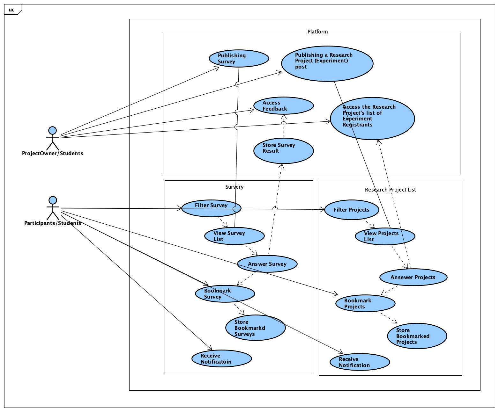
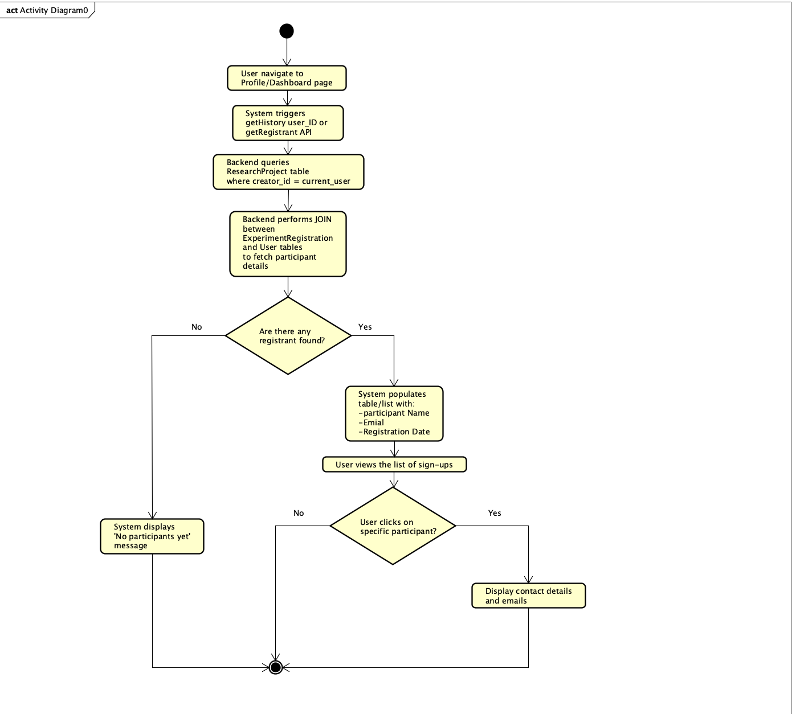
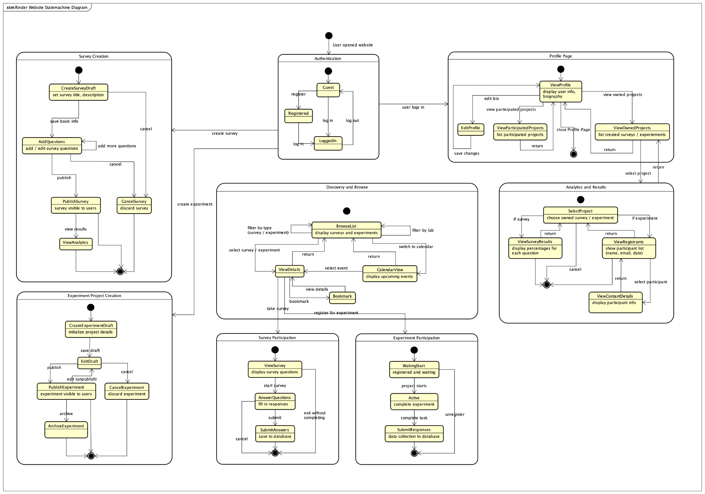
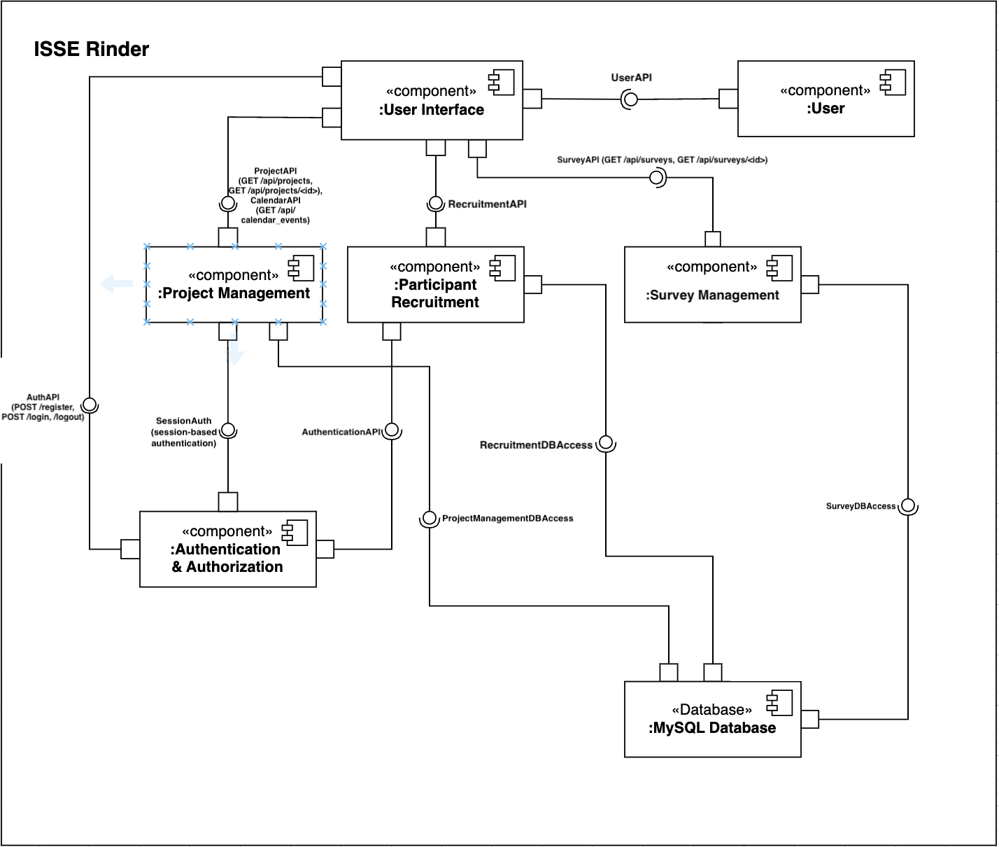
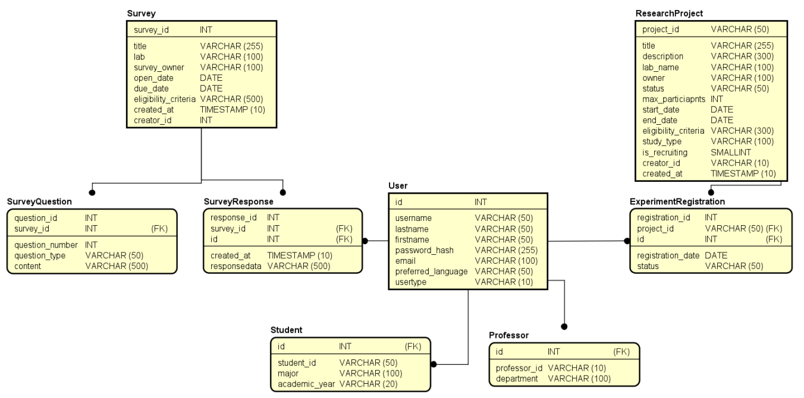
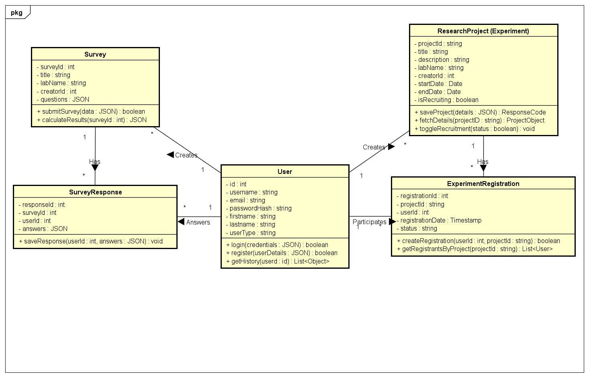
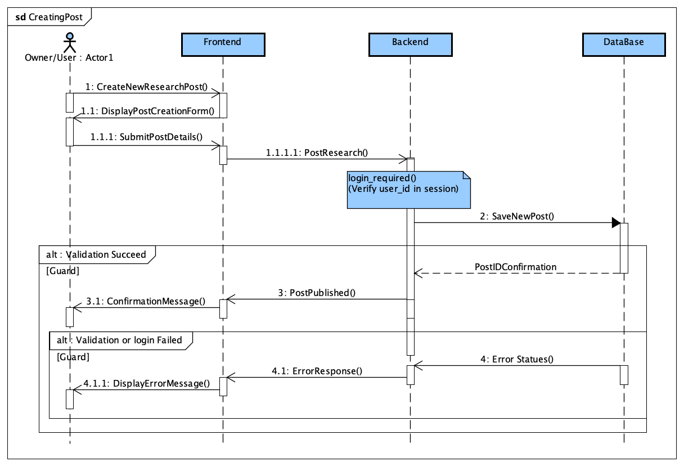
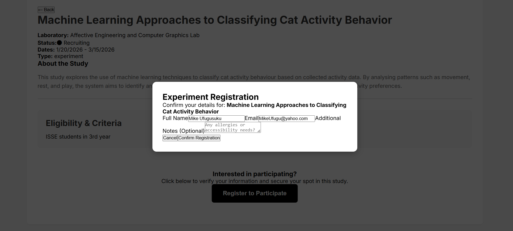
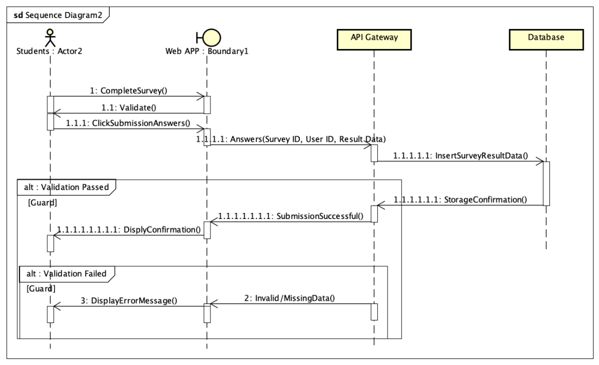

# PBL4: Group J Final Report

This page reproduces the report text and figures with layout adapted for GitHub. Test results are those recorded in the final report. Student IDs and personal email addresses from the cover page are omitted from this public copy.

[Back to the project README](../README.md)

## Authors

- Soco Great Gilbert Cansancio
- Sittitaworn Chidchanok
- Hori Kosei
- Sota Yatsugi
- Shiramizu Yuki

## I. Introduction

Rinder: ResearchMatch is a platform designed to support research participation and collaboration among ISSE students and researchers. It addresses the common difficulty of recruiting participants by providing a centralized space where users can advertise research projects, share surveys, and manage engagement more efficiently. Because first and second year students will need to prepare to choose a lab in their third year, the system also helps such students discover ongoing research within ISSE, enabling them to offer feedback and gain early insight into different laboratories [1]. The main objectives of Rinder: ResearchMatch are to streamline participant recruitment, increase visibility of student research, and foster a more open, collaborative research environment within ISSE. The scope of the PBL4 implementation includes creating and sharing surveys and research posts, completing surveys, expressing interest in specific projects, and browsing available studies through both list and calendar views. Future extensions will focus on the notification system.

## II. Requirements and analysis

### A. Functional Requirements

The functional requirements for Rinder focuses on enabling users to advertise research, share surveys, access opportunities, and manage participation. Users must be able to post studies, browse surveys or projects through list or calendar views, filter by type, bookmark projects, and receive notifications. System-level requirements support these actions by ensuring the platform can store survey results and bookmarks, publish posts reliably, filter data based on user criteria, display activities by timeline, and send timely notifications.

### B. Non-functional Requirements

Non-functional requirements focus on usability, performance, accessibility, and reliability. The interface must be intuitive, require no training, and allow users to find research quickly. The system should clearly present opportunities, support both English and Japanese, and function across devices and input methods. Performance expectations include loading lists within three seconds and returning filtered results within two. System-level constraints include secure data storage, accurate status updates, timely notifications, and dependable filtering. Together, these requirements shaped the design of Rinder: ResearchMatch to meet both user expectations and system constraints.

### C. Use Case Modeling and Behavioral Analysis

#### Figure 2.2 Use Case Diagram

The diagram above illustrates the core use cases of Rinder: ResearchMatch. The following use cases discussed are the main ones implemented in PBL4. Users can create surveys to collect structured data for their research projects, and they can create research project posts to advertise studies and recruit potential participants. They are able to complete surveys provided by researchers, and they can also submit experiment-interest participation forms to indicate their willingness to join specific studies. Finally, users can view survey results to analyze collected responses and access lists of experiment registrants to manage participant involvement.

#### Figure 2.3 Activity Diagram

The Activity Diagram illustrates the process for a project owner viewing their list of registrants. When the user opens their Profile or Dashboard, the system automatically sends a getHistory or getRegistrant API request using their user ID. The backend identifies projects created by the user and retrieves participant data through a JOIN between the ResearchProject, ExperimentRegistration, and User tables. If no registrants are found, the system displays a “No participants yet” message. Otherwise, it shows a table of participant names, emails, and registration dates. The user may select a participant to view their contact details, after which the activity ends, unless they choose not to select anyone.

#### Figure 2.4 State Machine Diagram

Figure 2.4 shows the end-to-end flow of user interactions within the Rinder: ResearchMatch platform. It shows how users move between authentication, browsing, creating surveys and experiment projects, participating in studies, and viewing analytics. Each subsystem, like Survey Creation, Experiment Project Creation, Discovery and Browse, Survey Participation, Experiment Participation, Profile Management, and Analytics, depicts the states users transition through as they draft, publish, participate in, and analyze research activities. The diagram captures both project creator/owner and participant workflows, highlighting how actions like logging in, creating content, completing tasks, and viewing results progress from one state to the next across the platform.

## III. System design

### A. Architectural Design

#### Figure 3.1 Component Diagram

The system architecture is organized around a set of modular components that separate major responsibilities such as user interaction, authentication, project management, participant recruitment, and survey management. At the front end, the User Interface component, which was implemented using React, handles all user interactions and issues requests through APIs (e.g., UserAPI, ProjectAPI, SurveyAPI). These requests are received by the backend, where multiple Flask-based components encapsulate the core application logic. Each component in Figure 3.3.1 implements their respective business logic, using dedicated endpoints like /api/projects, /api/recruitment, and /api/surveys that the frontend can call asynchronously [2]. Communication between components is modular and API-driven, while Cross-Origin Resource Sharing (CORS) ensures that frontend clients on different devices can securely access these backend services. All persistent data required by these components are stored in the central MySQL Database, accessed through specialized database access interfaces. This component-based architecture allows each subsystem to evolve independently. For example, the User Interface or Survey Management logic can be modified without affecting the underlying authentication mechanisms or database schema.

### B. Database Design

#### Figure 3.2 E/R Diagram

The project’s database uses a relational schema to maintain data integrity across all research-related entities, as shown in the E/R diagram. The core User entity employs inheritance to differentiate Studentsff and Professors, enabling role-specific attributes. One-to-many relationships link each user to the Surveys and ResearchProjects they create, while participation is handled through SurveyResponse and ExperimentRegistration tables that connect users to specific studies. Surveys are further broken down into SurveyQuestion to support flexible question counts. Overall, the schema provides a robust MySQL-based storage layer that supports the system’s dynamic behavior.

### C. Detailed Design

#### Figure 3.3.1 Coding Class Diagram

Figure 3.3.1 acts as a technical blueprint for the system’s internal logic, showing how the Flask backend and React frontend interact through defined methods and data structures. Unlike the previous E/R diagram, it highlights application behavior by outlining methods such as register, login, and add_project, which map directly to API routes in the Flask code. It also reflects how user state is managed through session-based authentication and the currentUser logic used to track ownership and participation. The diagram includes implementation-specific types to mirror the formData and fetch payloads used in React. Overall, it clarifies the application’s execution flow and distinguishes the dynamic logic from the underlying database structure.

#### Figure 3.3.2 Sequence Diagram for Creating a New Research ProjectPost

Figure 3.3.2 illustrates the use case of creating a new research post, showcasing the interaction between the user, the web application frontend, the API gateway, and the database. The process begins when the user initiates a request to create a new research post, prompting the web application to display the project creation form. Once the user submits the project details, the frontend transmits this information to the API gateway, which subsequently attempts to save the new post to the database. The system then utilizes an alternative structure to handle validation outcomes: if validation succeeds, the database confirms the post ID, and the API gateway notifies the frontend that the post is published, resulting in a confirmation message for the user. Also, if validation succeeds, another validation is performed to check if a user is logged in given that this ability is only for logged-in users. Conversely, if validation fails, which can occur with a database error or invalid input, the API gateway receives an error status from the database and triggers the frontend to display an appropriate error message to the user. This flow ensures that data is only persisted when valid and provides immediate feedback to the researcher throughout the creation lifecycle.

### D. User Interface Design

## IV. Implementation and technologies

### A. Technology Stack

The platform is built on a three-tier architecture utilizing a robust stack of open-source technologies designed for scalability and performance. The Presentation Tier is developed using React, a declarative frontend framework that allows for a responsive, component-based user interface as well as its efficient state management [3]. Together, these factors are essential for handling dynamic research data such as survey questions and project listings. The Logic Tier is powered by Flask, a Python micro-framework that acts as the system's API Gateway. Flask was because of its lightweight nature and it already has security libraries like werkzeug for password hashing and flask_session for managing user authentication states. For the Data Tier, the system utilizes a MySQL relational database. MySQL was chosen to enforce data integrity through strictly defined relationships, such as the one-to-many link between a survey_id and its corresponding entries in the survey_questions table, ensuring that research data remains consistent and structured. Communication between these tiers is done via Axios because of its inherently asynchronous HTTP requests and CORS configuration to ensure secure cross-origin data flow [4].

### B. Implementation Highlights

The implementation phase was characterized by a direct translation of the UML design models into a functional codebase, ensuring that the system's architectural integrity was maintained throughout development. A major highlight is the mapping of the Coding Domain Class Diagram to the backend's relational logic; specifically, the complex one-to-many relationship between a survey and its questions was implemented by utilizing the survey_id as a foreign key to link the survey and survey_questions tables. This architectural decision allowed the add_survey route to perform a multi-step database transaction—first creating the survey header and then iterating through a questions array to populate the child table—mirroring the structural requirements defined in the class models. Additionally, the Activity Diagrams served as a roadmap for the development of REST endpoints, where the sequential flow of user actions like registering for an experiment or submitting survey answers was directly translated into Flask routes protected by the login_required decorator. By adhering to the Sequence Diagrams, the frontend was programmed to handle both successful data persistence and error states through Axios, providing the asynchronous "Alt Fragment" logic that ensures the user is notified of either a successful publication or a database failure.

### C. Integration and Deployment

System communication is facilitated through a RESTful API architecture, where the React frontend functions as a client issuing asynchronous HTTP requests to the Flask backend. Data exchange is standardized using JSON payloads, utilizing GET methods for fetching project and survey listings and POST methods for submitting sensitive data like user credentials, research details, and survey details. To ensure consistency with the Component Diagram, the deployment environment is structured as a networked local-host setup where the frontend is served via Vite and the backend runs on a dedicated port (8080), with CORS explicitly configured to allow secure communication between the two distinct origins. The deployment process follows a systematic local-server model, beginning with the initialization of the MySQL relational schema to establish the necessary tables for users and research entities. Once the database is ready, the Flask application is launched to establish a connection via flask_mysqldb, followed by the activation of the React development server to provide the user interface. This tiered deployment ensures that the logic and data layers are fully operational before the presentation layer begins requesting resources.

### D. Participation form completion

The participation form completion feature allows students to express their interests in joining a specific experiment in a simple and structured manner. When a user selects a research project and clicks the “Register to Participate” button, the system displays an Experiment Registration form in a modal window. This form automatically pre-fills the user’s full name and email address based on their registered account information, reducing input time and preventing inconsistencies. Users may optionally provide additional notes, such as allergies or accessibility requirements, before submitting the form. Once the user confirms the registration, the frontend sends the participation data to the backend via a POST request. The Flask API then validates the user’s login status and stores the registration details including user ID and project ID, in the ExperimentRegistration table of the MySQL database. After the submission, the system confirms the registration and associates the participant with the selected research project. Project owners can later view a list of registered participants through their dashboard, enabling efficient participant management and follow-up communication. This process ensures a smooth and reliable workflow for experiment participation within the Rinder.

## V. Evaluation and testing

The testing phase followed an iterative Unit-to-Integration workflow to ensure that each feature was structurally sound before being merged into the full-stack environment. At the start, the frontend and backend teams operated independently to conduct Unit Testing, focusing on isolated logic such as React component rendering and Flask API endpoint validation. Once individual components passed these checks, the teams moved into Integration Testing, where the focus shifted to the seamless communication between the two tiers via Axios and the successful persistence of data in the MySQL database. This cycle was repeated for every core feature, starting with the login and register system and progressing through the creation and consumption of research projects and surveys. By testing in these discrete "sprints" of verifying registration, then creation, then participation, the team was able to isolate bugs early and ensure that the final system architecture remained consistent with the design models. Final System Testing was already completed and the results of which are in the following table:

### Table 1: Final Test Results Table

| Test Case ID | Feature/Module | Test Description | Expected Result | Status |
| --- | --- | --- | --- | --- |
| TC-01 | User Auth | Register a new user and log in. | Account created in DB; session token was issued. | Passed |
| TC-02 | Project Creation | Create a new Research Project | Entry appears in research_projects table of the DB | Passed |
| TC-03 | Survey Creation | Create a survey with multiple questions | Entries created in survey in survey and survey_questions tables | Passed |
| TC-04 | Project Directory | View a list of all available experiments | Fetch request returns all active projects | Passed |
| TC-05 | Survey Directory | View a list of all available surveys | Fetch request returns all surveys | Passed |
| TC-06 | Survey Submission | Complete a survey as a student. | Answers are JSON-stringified and saved to DB | Passed |
| TC-07 | Exp. registration | Submit interest in an experiment | User ID and Project ID linked in registration table. | Passed |
| TC-08 | Analytics | View feedback or results for a created survey | Percentages calculated correctly for each question | Passed |
| TC-09 | User History | View owned and participated in Profile. | History query joins data from all major tables | Passed |

## VI. Discussions and lessons learned

Through the development of our project Rinder, the team gained important insights into both technical implementation and collaborative software engineering practices. One significant point is the importance of clear requirements definition at an early stage. During the initial phase, some functional requirements such as participant history viewing and survey analytics were loosely defined, which have led to minor redesigns in the database schema and API endpoints. This experience taught us how precise requirement analysis can reduce rework and improve development more efficiently. For the technical part, the project demonstrated the effectiveness of a three-tier architecture using React, Flask, and MySQL. Separating the presentation, logic, and data layers made the system easier to maintain and debug, especially when integrating frontend and backend components developed by different team members. However, the team also learned that strong coordination is required and essential when defining API contracts, as mismatches in expected JSON formats or endpoint behaviors occasionally cause integration issues. The lessons we learned from database design is that implementing one-to-many relationships, such as surveys and their questions or projects and their participants, required careful planning of foreign keys and transaction logic. Handling multi-step operations, such as survey creation or experiment registration, emphasized the need for validation and error handling to prevent incomplete or inconsistent data states. Furthermore, communication in the team. Although it was difficult to schedule meetings that fit everyone’s availability, the team was able to communicate and share the progress using Discord and GitHub. Team members regularly shared their progress, which made it easy to understand how far each task had advanced. When someone finished their assigned task early, they often helped others with remaining work, allowing the team to work flexibility and efficiently. This continuous communication helped maintain awareness of overall progress and contributed to smooth collaboration throughout the project. Finally, the team learned the importance of incremental testing and continuous integration. By following a unit-to-integration testing strategy, errors were identified early and resolved before they affected the overall system. This improved system stability and ensured consistency between the UML design models and the final implementation. Overall, the project provided practical experience in applying software engineering principles to a real- world web application and highlighted areas for future improvement, such as scalability, notification automation, and enhanced analytics.

## VII. Conclusion

This project presented the design and implementation of Rinder, a web-based platform aimed at improving research participation and collaboration within the ISSE community. By addressing common problems such as recruiting participants for projects and limited research visibility. The system provides a centralized environment where 1st-year and 2nd-year students and researchers who are 3rd-year and 4th-year students can efficiently create, discover, and engage in research activities. Through features such as research project posting, survey creation, experiment registration, and result analysis, Rinder supports both research owners and participants throughout the entire research lifecycle. For the technical part, the project successfully applied software engineering principles including requirements analysis, UML-based system modeling, modular architecture design, and full-stack implementation. The use of three-tier architecture with React, Flask, and MySQL enabled a reliable data management .The system design models which are use case diagram, activity diagram, sequence diagram, class diagram, component diagram, state machine diagram, coding class diagram, E/R diagram, communication diagram were effectively translated into working code, demonstrating the consistency between design and implementation. Overall, Rinder demonstrates the feasibility and value of a research-matching platform tailored to the ISSE context. While future improvements may include enhanced notification systems, scalability optimizations, and expanded analytics, the current implementation provides a solid foundation for fostering early research engagement and collaboration among students. This project not only fulfills the objectives of PBL4 but also offers a practical solution that could be further developed and deployed in real academic settings.

## References

[1] Ritsumeikan University, ISSE Curriculum Overview. College of Information Science and Engineering, Ritsumeikan University. Accessed: Dec. 2025.

[2] Untitaker et al., Flask-Session Documentation. Accessed: Jan. 2026.

[3] Meta Platforms, Inc., React: A JavaScript library for building user interfaces, React Official Documentation. Accessed: Dec. 2026.

[4] M. Zabriskie, Axios Documentation. GitHub Repository. Accessed: Jan. 2025.

## Appendix

\*Note: This is just an additional Sequence diagram

### Figure 3.3.3 Sequence Diagram for Completing a Survey

Figure 3.3.3 details the end-to-end interaction between a student, the web application interface, the API gateway, and the database during the survey completion process. It begins with the student initiating the CompleteSurvey() action, followed by a frontend validation step to ensure all required fields are addressed before the user can click SubmissionAnswers(). The web application then bundles the survey ID, user ID, and result data into a request sent to the API gateway, which triggers an InsertSurveyResultData() command to the database. Utilizing an alternative structure based on data integrity, the system handles two potential outcomes: if validation is passed, the database provides a storage confirmation, leading the API gateway to signal a successful submission and the frontend to display a confirmation message to the student. In the event of validation failure—such as invalid or missing data—the API gateway immediately catches the error and instructs the web application to display an appropriate error message, ensuring the student is aware that their submission was not recorded.
